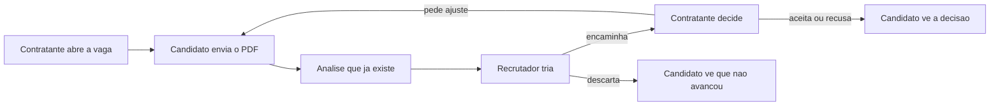

# Áreas e telas — três papéis

Mapa do produto com três áreas no mesmo app. Cada papel entra na própria área e não vê o menu dos outros. Eles só se encontram numa candidatura.

Documento irmão: [scope.md](scope.md). A porta, vaga e candidatura `SUBMITTED` já têm código; triagem e decisão do contratante ficam para o próximo corte.

## Processo

1. O **contratante** abre a vaga (título, descrição, o que procura). A vaga já nasce ligada a ele.
2. O **candidato** vê vagas abertas, envia o PDF e acompanha o status.
3. A **análise atual** (PDF → extração → feedback) roda nesse envio. Ninguém cola descrição de vaga na hora da análise. Comparação automática currículo versus vaga continua fora — ver [adr/0004-comparacao-vaga.md](adr/0004-comparacao-vaga.md). O recrutador usa o feedback que já existe para triar.
4. O **recrutador** não cria vaga. Ele vê a fila e só tem duas saídas: encaminhar ao contratante daquela vaga, ou descartar.
5. O **contratante** não vê a fila inteira. Vê só quem foi encaminhado e escolhe: aceitar, recusar ou pedir ajuste.
6. Pedido de ajuste volta para o candidato, que reenvia o PDF. A análise roda de novo.

### Status da candidatura

Nesta ordem lógica:

| Status | Quem move | O que o candidato vê |
| --- | --- | --- |
| enviada | candidato (envio ou reenvio) | Candidatura enviada |
| descartada | recrutador | Não avançou |
| encaminhada | recrutador | Encaminhada ao contratante |
| ajuste pedido | contratante | Pedido de ajuste + texto |
| aceita | contratante | Aceita |
| recusada | contratante | Recusada + texto |

Reenvio depois do ajuste volta para **enviada** e o recrutador tria outra vez.

## O que cada um vê do mesmo currículo

| Papel | Visão |
| --- | --- |
| Candidato | Feedback completo, inclusive sugestões do que melhorar |
| Recrutador | Dossiê de triagem (fortes, atenção, competências). Pode guardar uma nota interna — essa nota não aparece para o candidato nem para o contratante |
| Contratante | Leitura curta para decidir, sem o tom de "revise seu currículo" |

Recusa e pedido de ajuste levam um texto curto, visível ao candidato. Descarte do recrutador só aparece para o candidato como "não avançou", sem a nota interna.

## Entrada comum

Três portas, uma vez: **Candidato**, **Recrutador**, **Contratante**.

Não é login. Login, senha e conta continuam fora — ver [adr/0002-autenticacao-simples.md](adr/0002-autenticacao-simples.md). A porta só separa a área.

## Telas — Candidato

| Tela | O que faz |
| --- | --- |
| Início | Candidaturas em andamento, com o status em uma linha |
| Vagas | Lista do que está aberto |
| Vaga | Descrição e o botão de se candidatar. Uma candidatura por vaga |
| Enviar currículo | A tela atual de PDF |
| Análise | A tela atual de fortes, atenção e sugestões |
| Candidatura | Linha do tempo do status |
| Ajuste | O texto do contratante e o reenvio do PDF |

O histórico de análises que já existe continua aqui, como lista dos PDFs que o candidato mesmo enviou.

## Telas — Recrutador

| Tela | O que faz |
| --- | --- |
| Início | Vagas com fila de triagem e a contagem do que ainda não foi visto |
| Fila da vaga | Só candidaturas enviadas, ainda sem decisão do recrutador |
| Dossiê | Análise mais as ações Encaminhar e Descartar |
| Descartar | Nota interna opcional, só para ele |
| Acompanhamento | O que já foi encaminhado e qual foi a decisão do contratante |

O recrutador não cria vaga.

## Telas — Contratante

| Tela | O que faz |
| --- | --- |
| Início | Vagas dele e quantas decisões estão pendentes |
| Nova vaga | Título, descrição e o que procura |
| Vaga | Só os indicados pelo recrutador |
| Dossiê | Leitura curta da análise |
| Decisão | Aceitar, Recusar ou Pedir ajuste. Recusa e ajuste pedem um texto curto |

## Fora deste mapa

- Código, navegação e API — etapa seguinte
- Login e troca de papel na mesma conta
- Nota numérica, ranking entre candidatos e reescrita automática do currículo
- Chat, push e versão web
- Vários recrutadores na mesma vaga, ou recrutador criando vaga em nome da empresa
- Comparação automática do currículo com o texto da vaga
